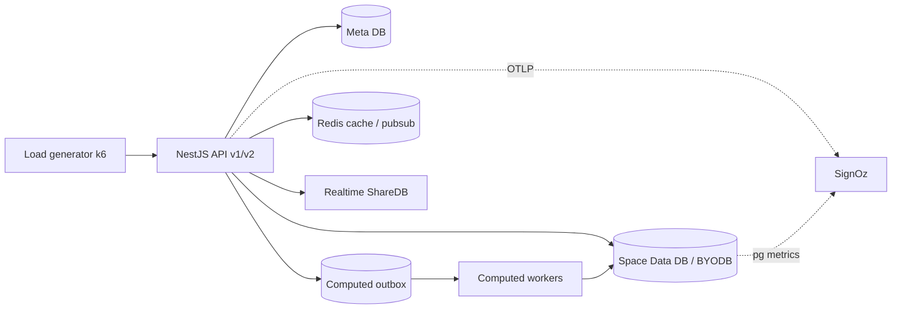

# 压力测试程序：方法、场景、评价与优化

日期：2026-10-19。状态：方案与基线，未在 staging 执行压测。

本文回答四件事：**怎么设计压测、压什么、怎么判定、怎么优化**。配套：

- [压测留痕契约](byodb-stress-evidence-contract.md)：Teable 证据表、字段、键与写入顺序。
- `teable-stress-testing` skill：执行时的短流程与硬门槛。
- `stress-tests/`：k6 脚本骨架，不是已执行结论。

仓库边界：本仓库拥有 deployment-level workload、seeder、收敛 SQL、长期调度、28-day baseline、判定、证据写入与报告；`teable-ee` 只提供产品 API/schema；ACK/AWS/RDS/SSM 适配器由 `teableio/teable-infra/scripts/loadtest/` 维护。

压测不是稳定性 SLO 的替代品。稳定性回答“日常流量下是否持续可靠”，压测回答“在多大负载、什么失败模式下、系统从哪里开始坏”。两者共用指标与证据口径，但不能互相签字。

## 1. 目标与边界

### 1.1 压测要回答的问题

| 问题 | 测试类型 | 主要证据 |
| --- | --- | --- |
| 脚本和链路是否通？ | smoke | 小流量请求、错误分类、trace |
| 日常峰值能否达标？ | load / baseline | 客户端与服务端 P95/P99、成功率、池等待 |
| 超过峰值后如何退化？ | stress | 拐点、错误类型、队列积压、恢复时间 |
| 长时间运行是否泄漏？ | soak | 内存、连接、outbox、延迟漂移 |
| 突发流量会不会打死？ | spike | 错误 burst、熔断/限流、恢复 |
| 容量上限在哪？ | breakpoint | 最大可持续 RPS、饱和资源 |
| 故障后能否恢复且不丢数据？ | chaos / recovery | 回读一致性、RPO/RTO、死信 |
| 代码改动是否真的更快？ | before/after | 同环境同数据集同场景的前后对比 |

### 1.2 压测不证明什么

- 不证明 30 天 SLO；压测窗口通常只有分钟到小时。
- 不证明客户数据正确性；必须另做写入—独立回读、公式收敛、协作可见性检查。
- 不证明生产拓扑完全等价；staging 的数据库规格、网络、租户分布、缓存命中率都可能不同。
- 不证明“零错误”；`client_error` 可能包含合法校验失败、权限拒绝和测试数据问题。
- 不证明灾难恢复；恢复演练必须单独做，见 `database-stability-observability.md` §4.3。

## 2. 方法论

### 2.1 测试类型

按 k6 的测试类型划分，并增加 Teable 需要的基线、容量与故障恢复：

| 类型 | 负载 | 时长 | 目的 | 通过条件（初始，需按基线校准） |
| --- | --- | --- | --- | --- |
| smoke | 1–5 VU 或 1–5 RPS | 1–3 min | 脚本、鉴权、表/视图、清理 | 无脚本错误；非预期响应为 0 |
| baseline | 生产同量级或固定低量 | 10–30 min | 固定环境与数据集的可比基线 | 指标完整；结果可重复 |
| load | 生产峰值 × 1.0 | 20–60 min | 日常峰值达标 | P95/P99 达 SLO；错误率 ≤0.1%；无持续池等待 |
| stress | 峰值 × 1.5–3.0 | 20–60 min | 过载退化 | 有界错误；无数据丢失；恢复 <5 min |
| soak | 峰值 × 0.5–1.0 | 2–8 h | 泄漏与累积 | 延迟漂移 <10%；内存/连接/outbox 不单调增长 |
| spike | 1 min 内到 5–10× 峰值 | 5–15 min | 突发与恢复 | 不崩溃；错误 burst 有界；恢复 <5 min |
| breakpoint | 阶梯上升直到失败 | 直到拐点 | 容量上限 | 记录拐点 RPS、首个饱和资源、失败模式 |
| chaos / recovery | 固定负载 + 故障注入 | 10–30 min | 故障恢复 | 回读一致；无死信增长；RTO 内恢复 |

### 2.2 负载模型：优先开放模型

压测要控制“到达率”，不是“同时有多少个循环”。两者在系统变慢时给出完全不同的结论。

- **开放模型**：请求按固定到达率发起，与响应时间无关。适合容量、压力、尖峰、拐点。k6 用 `constant-arrival-rate` / `ramping-arrival-rate`。
- **封闭模型**：上一个请求完成后才发下一个，吞吐被响应时间反向限制。适合模拟“固定用户数 + think time”的交互场景，不适合证明容量。
- **协调遗漏（coordinated omission）**：系统变慢时，封闭模型会少发请求，导致 P99 被低估。开放模型不会。若只能用封闭模型，必须同时报告 `dropped_iterations`、实际到达率与请求排队时间。
- **Little's law**：`并发 ≈ RPS × 平均延迟`。例：20 RPS × 0.35 s ≈ 7 个在途请求；若尾延迟 1.2 s，尾部的在途请求约 24 个。用它来估算压测机、连接池和线程/协程需求，不要用拍脑袋的 VU 数。
- **think time**：开放模型下不要把 think time 塞进请求函数；用到达率表达用户规模。需要模拟真实用户节奏时，单独跑封闭模型并标注。

### 2.2.1 工具选择

| 工具 | 优势 | 代价 | 适用 |
| --- | --- | --- | --- |
| k6 | JS 脚本、开放/封闭模型、阈值即代码、CLI/CI 友好、低开销 | 协议覆盖不如 JMeter；复杂场景要自己写模块 | **本项目首选**：HTTP/JSON + 开放模型 + CI |
| JMeter | GUI、协议/插件多、企业使用广 | JVM 重、脚本评审和版本管理差、开放模型不直观 | 需要非 HTTP 协议或既有 JMeter 资产 |
| Gatling | Scala/Java DSL、报告好、适合复杂场景 | JVM、学习曲线、团队 JS 更熟 | 长期维护的 Java 团队 |
| Locust | Python、易扩展 | 开放模型/分位数控制要额外实现，压测机开销较高 | Python 团队、快速原型 |
| 自研 Node/Go | 完全可控、可复用业务代码 | 必须自己实现直方图、开放模型、协调遗漏修正 | 只在 k6 无法表达时 |

选择 k6 的理由是“能正确表达到达率 + 能把阈值写进代码 + 能在 CI 里跑”，不是因为它功能最多。实时 WebSocket 场景可以另用 k6 `ws` 或独立客户端，但不要用同一个脚本混合 HTTP 与长连接后再比较分位数。

### 2.3 工作负载画像：从生产来，不靠猜

2026-10-18T05:00Z–2026-10-19T05:00Z（AI 生产，`teable.data_api.request.completed`，未采样计数）实测：

| 操作 | 请求数 | 占比 | 成功数 | 成功率 | P50 ms | P95 ms | P99 ms |
| --- | ---: | ---: | ---: | ---: | ---: | ---: | ---: |
| list | 683,931 | 76.67% | 666,169 | 97.40% | 47.6 | 349.2 | 1,185.5 |
| update | 75,390 | 8.45% | 74,014 | 98.18% | 88.1 | 432.9 | 1,340.3 |
| get | 61,589 | 6.90% | 60,682 | 98.53% | 31.2 | 230.7 | 969.9 |
| create | 38,375 | 4.30% | 31,162 | 81.20% | 97.3 | 571.8 | 1,517.9 |
| update_many | 23,950 | 2.68% | 23,947 | 99.99% | 125.9 | 682.5 | 1,487.8 |
| delete | 7,646 | 0.86% | 7,646 | 100% | 72.3 | 407.1 | 795.2 |
| delete_many | 1,150 | 0.13% | 1,117 | 97.13% | 131.4 | 347.2 | 427.1 |
| duplicate / form_submit | 15 | — | 15 | — | — | — | — |

峰值 5 分钟 6,148 请求（约 **20.5 RPS**），24h 均值约 **10.25 RPS**。总请求 892,046，成功 864,752（96.94%），其余主要是 `client_error`，不能直接当可用性失败。

使用规则：

- list 占绝对多数，读路径必须占混合负载的 70–85%。
- create 的 `client_error` 占 18.8%，先分类（校验/权限/重复/测试数据），再定 create 的错误门槛。
- P99 已接近或超过 1.5 s，`>5 s` 桶不可可靠估计；报告 P99 时同时报告 `>5 s` 比例。
- 压测目标从“峰值 × 倍数”开始，不直接抄 20.5 RPS；staging 的硬件和租户分布不同。

### 2.4 实验设计

1. **固定变量**：一次只改一个（代码 SHA、数据集、负载模型、pool 配置）。同一轮不要同时换代码和数据。
2. **预热**：至少 5–10 min，丢弃预热窗口；JIT、连接池、缓存、autovacuum 都需要时间进入稳态。
3. **稳态**：load 至少 20–30 min；soak 至少 2 h，最好 4–8 h。
4. **重复**：每个结论至少 3 次独立运行，取中位数并报告范围；不要用单次最好成绩。
5. **样本量**：每个场景至少 10,000 个成功请求再报 P99；错误率目标 <0.1% 时需要更大样本才能区分“0 次”与“很低但非零”。样本不足标 `inconclusive`，不要用 0/0 得出 100%。
6. **简单形状**：ramp-up → plateau → ramp-down。不要“过山车”式反复升降，否则无法归因。
7. **同环境对比**：优化前后必须同代码路径、同数据集、同场景、同 pool/feature flag；不同环境只能叫“观察”，不能叫“优化验证”。
8. **记录噪声**：压测机 CPU、网络、k6 `dropped_iterations`、GC、数据库 autovacuum、发布/迁移窗口都要记录。

### 2.5 指标分层

| 层 | 指标 | 用途 | 不能替代 |
| --- | --- | --- | --- |
| 客户端 | k6 `http_req_duration`、`http_req_failed`、`dropped_iterations`、实际 RPS | 用户视角的端到端延迟与到达率 | 服务端内部瓶颈 |
| 服务端 API | `teable.data_api.request.{started,completed,active}`、`request.duration` | 无采样分母、成功率、服务端 P95/P99 | 数据库与队列内部 |
| 表查询 | `teable.table_query.{requests.total,errors.total,duration.ms,db_parent.duration.ms,search.*}` | v2 查询/搜索路径、fallback | v1 与写入 |
| 数据库 | `teable.database.client.operations`、`operation.duration`、`pool.{waiting,connections,limit}`、`pool.acquire.timeouts` | 实例级吞吐、延迟、池饱和 | SQL 语义正确性 |
| 计算队列 | `v2.computed.outbox.{backlog,oldest_due.age}`、`queue.{workers,reachable,jobs}`、`reliability.*` | 写放大、积压、死信、收敛 | 用户请求成功率 |
| 实时 | `realtime.{operations.total,operations.errors,publish.total,connections.active}` | 协作广播与连接稳定性 | 数据库写入 |
| 基础设施 | CPU、内存、磁盘 IO、网络、PG 锁/长事务/WAL/复制 | 饱和定位 | 业务正确性 |
| 正确性 | 写入—独立回读、公式收敛、双客户端可见性 | 数据不丢、不算错 | 性能数字 |

分位数规则：

- 跨 Pod 先合并直方图桶再算分位数；**禁止平均各 Pod 的 P95/P99**。
- 同一窗口内先算分子/分母，再算比例；不要平均每分钟成功率。
- 报告 P50/P95/P99/P99.9、最大值、`>阈值` 比例和样本数；样本不足时标 `inconclusive`。
- 失败请求不计入成功延迟直方图；失败率必须与延迟一起展示。

### 2.6 评价：先门槛，后评分

压测结论用“门槛 + 证据”表达，不用一个模糊的总分。

**通用门槛**

- 数据正确性：写入后独立回读一致；公式/关联在截止时间内收敛；无新增死信。
- 可用性：`success / (success + server_error + throttled + aborted + unexpected)` 达该场景门槛；`client_error` 单独分类，不静默剔除合法拒绝。
- 延迟：按操作和数据集规模设 P95/P99，不用一个全局阈值。
- 饱和：池等待不持续 >0（基线 24h 最大 0.4）；outbox `oldest_due.age` 不持续超过 60 s；无持续锁等待；CPU 不长期 >80%（或按容量规划）。
- 恢复：压力撤除后 5 min 内回到基线延迟与队列深度。
- 可重复：3 次运行的中位数与范围；结论不能只来自一次“绿灯”。

**容量表达**

```text
最大可持续 RPS = 满足 SLO 的最高到达率
容量余量 = (最大可持续 RPS - 生产峰值 RPS) / 生产峰值 RPS
建议目标 = 生产峰值 × 1.5–2.0（按业务增长与故障域确定）
```

不要用“平均 RPS”做容量承诺；用峰值窗口、P99 和错误预算一起表达。

### 2.7 安全与隔离

- 只在专用 staging / perf 环境压测；**默认不压生产**。若必须生产验证，先取得书面批准，限流、限时、可中止，并排除真实租户。
- 专用 Space/Base、专用 access token、最小权限；测试表 ID 加入 `DATA_API_OBSERVER_TABLE_IDS`，避免探针/证据流量污染 SLO。
- 压测数据与客户数据隔离；BYODB 只写明确配置的测试库，不能写客户业务表。
- 先 smoke，再 load，再 stress/soak/spike；每次只升一档。
- 预设中止条件：5xx > 阈值、池等待持续 >60 s、outbox 最老任务 >5 min、数据库 CPU >90% 持续 5 min、压测机 `dropped_iterations` >1%。
- 清理：按 run_id 删除测试记录/表/Base；保留证据行与原始产物链接。

## 3. Teable 产品模型与热点

### 3.1 请求与写入路径



关键事实：

- 记录 API 的观测只覆盖 `/api/table/:tableId/record…`；`operation` 为 list/get/create/update/update_many/delete/delete_many/form_submit/duplicate。批量操作按 HTTP 请求计数，不按行数。
- v2 命令路径：`CreateRecordsHandler` → 事务 → `insertMany`（默认批 500）→ 计算变更；sync 策略或 hybrid 单记录内联执行，hybrid 批量/延迟任务进 outbox。
- outbox worker 用 `FOR UPDATE SKIP LOCKED` 领取；默认每 base 并发 2、每 seed table 并发 1；lease 120 s、心跳 30 s、最多 8 次重试、退避 5 s–5 min。
- 计算写放大的高风险形态：hub fan-out（1 源 → 10/100/500/1,000 目标）、5 层公式链、条件 lookup/rollup、对称 link、整表 seed-all、宽计算 schema。
- 搜索：`pg_bigm`（≥2 字符）/`pg_trgm`（≥3 字符）生成列 + GIN；不满足时回退 `ILIKE`。生成列和 GIN 会增加写放大。
- 多租户：默认库与 BYODB 分开；PG pool 默认 20，BYODB 默认 5，获取超时 5 s；池按连接身份复用，后到的不同 max 会被忽略。
- 实时：ShareDB + Redis pub/sub；广播量与 DB 写入量要分开测。

### 3.2 已知基线异常（压测前先处理）

2026-10-18/19 的 24h 基线里：

- `v2.computed.outbox.oldest_due.age{storage=default}` 最大值约 **2,679,741,520 ms（约 31 天）**，所有生产 Pod 同时存在；同期 `due_pending` 仅约 40。可能是暂停 scope、长期任务或指标口径问题。**先查清，不能把它当正常阈值。**
- `teable.database.client.pool.acquire.timeouts{role=meta}` 24h 有 **12** 次；`data` 为 0。需确认是否集中在发布/连接抖动窗口。
- `pool.waiting` 最大 0.4、`pool.connections` total 最大 17、active 最大 3.4，日常池有较大余量。

这些异常不影响压测方法，但会影响“基线是否健康”的判断。压测报告必须单独列出，不可用压测绿灯覆盖。

### 3.3 AI 与表核心必须分开压测

AI 的延迟和成本由 provider、模型、token 数决定，不能和表核心的 list/update P95 混在一个 SLO 里。正确做法是分轨：

| 层级 | 做什么 | token 成本 | 能证明什么 | 不能证明什么 |
| --- | --- | --- | --- | --- |
| L0 mock/replay | mock provider，压 Gateway/Proxy/队列/SSE/计费/重试/熔断 | 0 | Teable 侧链路、并发、错误分类、成本安全 | 真实模型容量、真实 TTFT |
| L1 real canary | 便宜模型、≤50 请求、max_tokens≤64、硬预算 | 低 | 真实 provider 对接、token 账、单次成本 | 容量、长期稳定性 |
| L2 record/replay | 录制真实响应后回放，不调用 provider | 0 | 重复压测与回归 | 新模型/新 provider 行为 |
| L3 provider capacity | 由 provider 侧或专门配额做 | 高 | provider 限流/配额 | 不应由 Teable 压测承担 |

硬规则：

- 默认只做 **L0 mock**；真实模型只做 **L1 小样本 canary**，且必须有 `AI预算USD`、请求数上限、`max_tokens` 上限、超预算立即停。
- 不对真实模型做高并发/soak/spike；那是在烧钱测 provider，不是测 Teable。
- AI 指标独立：网关开销、队列等待、TTFT、tokens/request、cost/request、缓存命中、provider 错误分类、预算状态。
- AI 延迟不进入核心表 SLO；核心表 P95 也不包含 AI 生成时间。
- AI 场景必须记录 `Token成本`、`成本控制`、`安全等级`；mock 运行的 `Token数`/`实际AI成本USD` 必须为 0。

AI 表面：AI Gateway、AI Proxy、AI 字段生成队列、Chat 流式、Agent/Sandbox 生命周期、credit/预算、429/超时/熔断。

## 4. 场景矩阵

每条场景都要固定：入口、数据集、负载模型、目标、指标、判定、风险。初始阈值需用 baseline 校准。完整的 45 个场景定义（31 core + 10 AI + 4 chaos）在 base 的 `压测场景目录`；下面 S1–S20 是核心执行子集，A1–A9 是 AI 子集。

| ID | 场景 | 入口 | 数据集 | 负载 | 主指标 | 初始判定 | 主要风险 |
| --- | --- | --- | --- | --- | --- | --- | --- |
| S1 | 列表读取 | `GET /api/table/{tableId}/record?viewId=&take=` 或 `GET /api/v2/tables/listRecords` | 1M 行、30–100 字段、常用视图 | 开放模型 50–200 RPS | 客户端 P95/P99；`table_query.duration`；DB P95 | P95 ≤1 s，P99 ≤3 s，错误 ≤0.1% | 全表扫描、宽投影、排序溢出 |
| S2 | 单记录读取 | `GET …/record/{recordId}` 或 v2 `getRecord` | 同 S1，随机 ID | 100–500 RPS | P95/P99；DB 操作数 | P95 ≤300 ms，P99 ≤1 s | N+1、缓存穿透 |
| S3 | 单条创建 | `POST …/record` 或 v2 `createRecord` | 含 5–20 个计算字段 | 20–100 RPS | P95/P99；outbox 入队；DB 写延迟 | P95 ≤800 ms，P99 ≤2 s，错误 ≤0.1% | 计算内联、写放大 |
| S4 | 单条更新 | `PATCH …/record/{recordId}` 或 v2 `updateRecord` | 含 formula/lookup/rollup | 20–100 RPS | P95/P99；outbox backlog/age | P95 ≤800 ms，P99 ≤2 s | 事务过长、锁竞争 |
| S5 | 批量更新 | `PATCH …/record`（records 数组）或 v2 `updateRecords` | 100/1,000/5,000 行/批 | 1–20 批/s | 批耗时、DB P95、锁等待 | 1,000 行 ≤60 s；无死锁 | 大批事务、WAL、锁 |
| S6 | 计算 fan-out | 更新 1 条源记录，触发 10/100/500/1,000 目标 | hub-and-spoke 模板 | 1–20 源更新/s | 请求 P95；outbox age；收敛时间 | 收敛 P99 ≤10 s；无死信 | seed-all、重复计算 |
| S7 | 公式链 | 更新链头，5 层 formula/lookup/rollup | 5 层链、每层 10–100 行 | 1–10 更新/s | 收敛时间；worker 并发 | 收敛 P99 ≤10 s | 阶段预算、循环 |
| S8 | 搜索 | `listRecords?search=["probe"]` | 10M 行文本；`pg_bigm`/`pg_trgm`/fallback | 10–100 RPS | `table_query.search.*`、fallback 率 | P95 ≤1 s；fallback 符合预期 | 短 probe 全表扫、GIN 写放大 |
| S9 | 视图筛选/排序/分组 | `listRecords?viewId=&filter=&sort=&groupBy=` | 1M 行、select/date/number 过滤 | 50–200 RPS | P95；DB P95；temp/IO | P95 ≤1.5 s；无磁盘排序 | 索引不匹配、分组爆炸 |
| S10 | 实时协作 | WebSocket 提交 + 第二客户端确认 | 10–100 并发客户端 | 1–20 更新/s | 可见性 P99；publish；连接错误 | P99 ≤2 s；无断连风暴 | 广播放大、重连 |
| S11 | 导入/导出 | `POST /api/import/.../stream`、导出 | 100k/1M 行 | 1–5 并发 | 吞吐、内存、错误 | 1M 行完成且内存有界 | 内存物化、长事务 |
| S12 | Schema 变更 | 创建/删除字段、重建搜索索引 | 1M 行、带计算依赖 | 后台 + 持续写 | 写入错误、outbox、索引耗时 | 无丢写；索引可用；可回退 | 长锁、写放大、回退 |
| S13 | 故障恢复 | kill worker / Redis 重启 / DB 切换 | 任意 | 固定负载 | 错误 burst、恢复时间、死信 | RTO 内恢复；无数据丢失 | 租约过期、重放 |
| S14 | 宽表读取 | `listRecords` + projection 50/100/300 列 | 1M 行、300 字段、10 个计算列 | 开放模型 20–100 RPS | 客户端 P95/P99；序列化/网络；DB P95 | 50 列 P95≤1 s；300 列 P95≤2 s、P99≤5 s | 宽行序列化、网络放大 |
| S15 | 高基数分组聚合 | `groupBy` 1 万组 + count/sum/avg | 1M 行、10k 分组、80/20 偏斜 | 开放模型 20–100 RPS | P95/P99；temp/内存；分组完整性 | P95≤2 s；无 OOM；分组结果完整 | 分组爆炸、临时文件 |
| S16 | 深分页 | cursor vs offset 100k | 10M 行、稳定排序键 | 开放模型 20–100 RPS | 扫描行数；P95；DB P95 | cursor P95≤1 s；offset 深页需明确上限 | offset 扫描放大、缓存失效 |
| S17 | 粘贴/填充/撤销 | UI paste 1,000 单元格 → fill → undo/redo | 1M 行、50 字段、含公式/link | 封闭模型 10–50 用户 | 操作 P95；值一致性；undo 后版本 | 粘贴 P95≤2 s；撤销后值一致；无重复行 | 批量写、undo/redo 放大 |
| S18 | 共享表单/匿名视图 | 公开 form submit + share view 读 | 目标表 1M 行；公开视图命中 10% | 开放模型 50–500 RPS | P95/P99；写入回读；权限/限流 | 表单 P95≤1 s；视图 P95≤1.5 s；无越权 | 反滥用校验、匿名缓存、越权 |
| S19 | 复制大 Base / Trash 恢复 | duplicate 1M 行 Base；删除 10% 后 restore | 20 表、总 500 万行 | 维护窗口 | 完成时间；在线读影响；行数/值一致 | 复制/恢复完成；在线读不超时；无重复 | DB 拷贝、连接池、清理任务 |
| S20 | 多租户热点/BYODB | 1 个热点 Base + 100 个长尾 Base 共享 BYODB pool | 热点 1M 行；长尾 1–10 万行 | 开放模型 50–200 RPS | 长尾 P95；pool waiting；跨库错误 | 长尾退化≤2x；无跨库错写；池获取≤5 s | noisy neighbor、pool 复用、路由 |

### 4.1 混合负载

生产混合负载按 2.3 的比例构造，建议两档：

| 档位 | list | get | create | update | update_many | delete | 目标 |
| --- | ---: | ---: | ---: | ---: | ---: | ---: | --- |
| read-heavy | 80% | 10% | 3% | 5% | 1.5% | 0.5% | 验证读路径与缓存 |
| write-heavy | 60% | 5% | 10% | 15% | 8% | 2% | 验证写放大与 outbox |

混合负载必须同时报告“按操作的 P95/P99”和“整体成功率”；整体延迟会被 list 稀释，不能只看一个总数。

### 4.2 数据集

| 名称 | 规模 | 字段/关系 | 用途 |
| --- | --- | --- | --- |
| small | 10 万行 | 30 字段、2 层计算 | smoke、快速回归 |
| business | CRM/ecommerce/project/HR；默认 CRM ≈ 5 万+ 行 | 5–6 表：主数据 + 关联 + 公式；可调规模 | 真实 CRUD、计算、批量、关联 |
| medium | 100 万行 | 50–100 字段、5 层链、1k 基数 | load、搜索 |
| large | 1,000 万行 | 100–300 字段、宽表、10k+ 基数 | breakpoint、搜索、导出 |
| fanout | 1 源 → 10/100/500/1,000 目标 | link/lookup/rollup | S6/S7 |
| skew | 80/20 分布、热点 Base | 单租户高流量 | 多租户与池 |

数据集必须记录：行数、字段数、字段配置、基数、偏斜、生成脚本、校验和。生产克隆优先用快照恢复，不用 API 逐条造数；API 造数适合小数据和端到端真实性验证。真实业务数据用 `stress-tests/tools/business-data.mjs`，支持 `--domain crm|ecommerce|project|hr`；`--scale` 只缩放根实体，子表比例保持不变：

```bash
node stress-tests/tools/business-data.mjs --domain crm \
  --customers 2000 --orders-per-customer 8 --items-per-order 3 --products 200
```

开发/测试库可以用 v2 devtools 直接生成可复现数据（直接写库，不走 API，不能用来测 API 吞吐）：

```bash
pnpm --filter @teable/v2-devtools cli mock generate \
  --table-id tbl... --count 1000000 --seed 42 --batch-size 500
```

生成后记录行数、字段数、基数和校验和；生产克隆用快照恢复，避免造数本身改变分布。

### 4.3 AI 场景（独立轨）

AI 场景与表核心分开记录、分开看板、分开预算。默认全部用 mock/replay；真实模型只做小样本 canary。

| ID | 场景 | 入口 | 负载 | token 成本 | 初始判定 |
| --- | --- | --- | --- | --- | --- |
| A1 | AI Gateway mock 路由 | Gateway/Proxy + mock provider | 开放模型 50–200 RPS | 0 | 网关开销 P95≤200 ms；路由/计费准确；无真实调用 |
| A2 | AI Gateway 真实 canary | Gateway + 便宜模型 | 20–50 请求，低并发 | 低，硬预算≤$1 | 无超预算；记录 token/成本；不作容量结论 |
| A3 | AI 字段生成 mock | 生成队列 + mock provider | 100–1000 任务 | 0 | 队列不丢；重试有界；写回正确 |
| A4 | AI 字段生成真实 canary | 生成队列 + 真实模型 | 10–20 次 | 低，硬预算≤$2 | 写回正确；token/成本有记录 |
| A5 | AI Chat mock 流 | SSE/WebSocket + mock provider | 20–100 并发 | 0 | TTFT P95≤500 ms；断连可恢复；无重复消息 |
| A6 | AI Proxy mock 计费 | Proxy + mock upstream | 开放模型 50–200 RPS | 0 | 计费准确；额度拦截；无重复扣费 |
| A7 | 429/超时/熔断 | mock provider 错误注入 | 10–100 并发 | 0 | 重试有界；熔断/半开正确；无重试风暴 |
| A8 | 预算/credit 硬停 | mock usage + 计费 | 逐步逼近上限 | 0 | 达上限即停；无超额扣费 |
| A9 | Agent/Sandbox 生命周期 | sandbox API + mock 模型 | 10–50 并发 | 0 | acquire P95≤5 s；无 sandbox 泄漏 |

真实 canary 的预算、请求数、`max_tokens`、模型和 provider 必须写在 `压测场景目录.成本控制` 与 `压测运行.AI预算USD`；超预算立即中止并记 `over_budget`。

## 5. 环境与执行

### 5.1 环境对齐清单

- [ ] 相同代码 SHA / 镜像 tag；记录 `BUILD_VERSION`。
- [ ] 相同 PG 大版本、扩展（`pg_bigm`/`pg_trgm`）、参数、autovacuum。
- [ ] 相同实例规格或明确 scale factor（CPU/内存/IO）。
- [ ] 相同 pool 配置（`DATABASE_POOL_MAX`、`BYODB_DATA_DB_POOL_MAX`、DSN `connection_limit`）。
- [ ] 相同 Redis/缓存模式、实时开关。
- [ ] 相同 OTel/SigNoz 导出、指标未采样、trace 采样比例。
- [ ] 相同 feature flag：v2 路由、`V2_TABLE_QUERY_OPS_*`、计算策略（sync/hybrid）。
- [ ] 相同数据量级、字段形态、基数、租户分布。
- [ ] 压测机独立，不与 API/DB 争抢 CPU；记录压测机到入口的网络延迟。
- [ ] 无其他测试/发布/迁移并发；记录窗口。
- [ ] staging 与生产同镜像/同配置；任何不能对齐的项（规模、网络、租户分布）写进 `环境基线`，不能默默忽略。
- [ ] staging 数据 DB 独占；确认 autovacuum/统计信息已收敛，避免把首次运行当成稳态。
- [ ] 若 staging 与生产共用 SigNoz，先建环境/Pod 过滤和独立 dashboard；禁止用全局 30 天数据算 staging 成功率。
- [ ] 清理任务、run_id 命名、证据写入 token 已就绪；压测数据可按 run_id 删除。

### 5.2 执行顺序

1. **Preflight**：冻结环境；创建专用 Base/表/视图/token；写入数据集；记录校验和；配置监控面板。
2. **Smoke**：1–5 RPS，验证鉴权、读写、清理、trace 关联。
3. **Baseline**：固定低量或生产同量级，跑 10–30 min，记录基线。
4. **Load**：生产峰值 ×1.0，20–60 min。
5. **Stress / Spike / Soak / Breakpoint**：按问题选择，一次一档。
6. **Chaos**：固定负载下注入故障，验证恢复与正确性。
7. **Cleanup**：删除测试数据；保留证据行、k6 JSON、trace 链接、SQL 计划。
8. **Review**：填结论、瓶颈、优化项；必要时开下一次验证运行。

### 5.3 压测脚本骨架

`stress-tests/k6/` 提供可执行的 k6 骨架：

```bash
# 语法/配置检查（不需要服务端）
docker run --rm -v "$PWD/stress-tests":/stress -w /stress grafana/k6 inspect k6/scenarios/read.js

# smoke
BASE_URL=https://staging.example.com TOKEN=... TABLE_ID=tbl... VIEW_ID=viw... \
PROFILE=smoke \
docker run --rm -i -v "$PWD/stress-tests":/stress -w /stress \
  -e BASE_URL -e TOKEN -e TABLE_ID -e VIEW_ID -e PROFILE \
  grafana/k6 run k6/scenarios/read.js
```

脚本只做压测，不负责造数或清理；数据集和清理由独立任务负责。脚本会给每个请求注入 W3C `traceparent` 与 `baggage`：`traceparent` 保证 trace 连续，`baggage` 携带 `run_id`/`scenario`，但是否落成 span attribute 取决于服务端 processor（当前未验证）。`run_id` 不进入 metric label（避免高基数）。

### 5.4 环境就绪前可完成的工作

以下工具已实现并用本地 mock 验证，staging 就绪后直接换 `BASE_URL`/token：

```bash
# 工具回归（mock Teable + mock AI）
node --test stress-tests/test/tools.test.mjs

# 只读预检
BASE_URL=https://staging.example.com TEABLE_TOKEN=... \
TABLE_ID=tbl... VIEW_ID=viw... API_KIND=v2 \
node stress-tests/tools/preflight.mjs --json

# 造 small 数据集（medium 用 devtools/snapshot，large 用快照）
BASE_URL=https://staging.example.com TEABLE_TOKEN=... TEABLE_BASE_ID=bse... \
node stress-tests/tools/seed.mjs --manifest stress-tests/datasets/small.json --limit 10000

# 真实业务数据（行数可调）
node stress-tests/tools/business-data.mjs --domain crm \
  --customers 2000 --orders-per-customer 8 --items-per-order 3 --products 200

# 从 k6 summary 生成 canonical bundle 草稿（仍需补服务端指标/结论/trace）
node stress-tests/tools/bundle-from-k6.mjs --summary summary-read.json --out run-bundle.json \
  --run-id lst_... --env staging --category core --scenario-set readmix_v1 \
  --scenario-id core.crud.list_plain --mode shared --repeat 1

# 持久化判定与证据写入
BASE_URL=https://staging.teable.ai TEABLE_TOKEN=... \
node scripts/stress/record-run.mjs --bundle run-bundle.json

# AI L0：mock provider，零 token
node stress-tests/tools/ai-mock-server.mjs
AI_PROXY_URL=http://localhost:18081/v1/chat/completions AI_PROFILE=mock \
  k6 run stress-tests/k6/scenarios/ai-proxy.js
```

环境未就绪时，本仓先完成工具回归、mock 端到端 smoke、数据集 manifest 评审和 AI mock/预算脚本评审；证据 writer 与判定模型的回归由 `scripts/stress/` 负责。真正需要环境才能做的只有：真实鉴权、真实数据量、真实 SigNoz 窗口、真实 DB/池/outbox 行为。

## 6. 留痕与 app 指标

留痕分五层：

0. **场景目录**：可复用场景定义，记录表形态、数据形态、操作组合、成本与安全等级；核心与 AI 分开分类。
1. **运行**：一次压测一行，绑定环境、代码、数据集、负载模型、目标、结果、判定；填 `分类=core|ai|mixed|chaos`。
2. **场景**：每个场景/档位一行，记录客户端与服务端分位数、错误分类、饱和资源、拐点；链接场景目录。
3. **指标窗口**：每个关键服务端/DB/队列指标一行，带窗口、阈值、来源、查询收据、源头链接；AI 指标带 token/成本。
4. **瓶颈**：每个瓶颈一行，记录现象、证据、根因、动作、前后对比、验证运行。

表 ID、字段 ID、键格式、写入顺序和 app 查询示例见 [压测留痕契约](byodb-stress-evidence-contract.md)。

app 指标接入原则：

- app 的“压测”页读 `压测运行` → `压测场景结果` → `压测指标窗口`；`瓶颈与优化` 作为下钻。
- 每个数字都能点到原始 SigNoz 查询或 trace；没有链接的数字不进 app。
- `run_id` 只放 trace/log 的 baggage 与证据表，不放 metric label；metric 用环境 + 窗口 + operation/instance 关联。
- 压测流量与稳定性 SLO 流量分开：专用 Base/表，必要时加入 `DATA_API_OBSERVER_TABLE_IDS`；压测结果不写进 `稳定性指标快照`。
- app 的“压测”页按 `分类` 分 tab：core / ai / chaos；默认不把 AI 与 core 放进同一个 P95 或成功率。
- AI tab 展示网关开销、队列、TTFT、token/成本、预算状态；mock 运行显示 token=0，真实 canary 显示预算与单价。
- 场景目录驱动筛选：按 `分类`、`表形态`、`Token成本`、`安全等级` 过滤；没有目录行的场景不允许进入 app。
- app 默认展示最新一次运行与最近 7 天趋势；跨运行比较必须同场景集、同数据集、同环境。

## 7. 优化闭环

### 7.1 顺序

1. **定位饱和资源**：先用 USE（utilization/saturation/errors）看 CPU、内存、IO、连接、锁、队列；再用 RED（rate/errors/duration）看请求。
2. **拿证据**：k6 分位数 + 服务端指标 + 慢 trace + SQL 计划 + 队列/池快照。没有 trace 或计划，不进入改代码。
3. **写假设**：一句话说明“哪个资源/哪条 SQL/哪个阶段导致哪个指标”。
4. **最小改动**：先加 trace、减重复读、减投影宽度、减批次数；不要一次改多个层。
5. **同场景验证**：同环境、同数据集、同负载，至少 3 次；对比中位数与范围。
6. **留痕**：更新 `瓶颈与优化`，填前后 P95/P99、变化百分比、验证运行 ID、代码变更链接。

### 7.2 瓶颈分类

| 现象 | 证据 | 常见根因 | 优先动作 |
| --- | --- | --- | --- |
| list P95 高、DB P95 低 | 服务端 P95 vs DB P95 差距 | 序列化、权限、插件、重复查询 | trace 分解；减投影/重复读 |
| DB P95 高、顺序扫描 | `EXPLAIN`、`pg_stat_statements` | 缺索引、统计信息过期、表达式不匹配 | 建索引/更新统计/改访问路径 |
| 池 waiting/acquire timeout | `pool.waiting`、`acquire.timeouts` | pool 太小、长事务、BYODB 多租户 | 查长事务；调 pool；隔离租户 |
| 锁等待/死锁 | `pg_locks`、wait events | 大事务、批量更新顺序不一致 | 缩短事务、排序/分批 |
| outbox backlog/age 上升 | `backlog`、`oldest_due.age` | fan-out 过大、worker 并发不足、seed-all | 拆批、调并发、查重复计划 |
| 搜索慢/全表扫 | `table_query.search.*` fallback | probe 太短、索引不可用、覆盖不匹配 | 修索引/能力；限制短 probe |
| 实时延迟/断连 | `realtime.*`、连接数 | 广播放大、压缩/重连 | 批量广播、压缩、限流 |
| CPU/event loop 高 | profile、event loop lag | JSON、序列化、同步计算 | 减 payload、异步化、缓存 |
| 内存上涨 | heap snapshot、RSS | 大结果集、缓存无界 | 流式、上限、回收 |

### 7.3 优化验收

- 同场景、同数据集、同环境，至少 3 次。
- P95 或 P99 改善超过运行间噪声（建议 ≥10% 且区间不重叠）；否则标“未验证”。
- 成功率、正确性、outbox 收敛、实时可见性没有退化。
- 代码变更、trace 链接、前后对比表都进证据表；缺一项不算 verified。

## 8. 后续路线

按“先核心、后 AI；先 baseline、后极限”的顺序推进。每一步都要产出一个 `压测运行` 行，不用口头结论。

| 阶段 | 工作 | 产出 | 不做 |
| --- | --- | --- | --- |
| P0 环境与数据 | 用 `stress-tests/tools/preflight` + `stress-tests/tools/seed` + `scripts/stress/record-run.mjs` 演练；冻结 staging；建 small/medium/large/fanout/skew 数据集；建专用 Base/token；确认 SigNoz/OTel 过滤 | `压测数据集` 5 行 + 环境基线 + 一次 mock 端到端运行 | 不压生产；不跑真实 AI |
| P1 核心 baseline | smoke + S1–S5 + S14 宽表；校准门槛；先查 31 天 outbox age 与 meta pool timeout | 核心 baseline 运行 + 场景结果 | 不做 breakpoint、soak |
| P2 核心深水区 | S6–S9 计算/搜索/视图；S15–S17 聚合/深分页/粘贴；S18–S20 共享/多租户 | 每个场景一条结果 + 瓶颈行 | 不混 AI |
| P3 稳定性与容量 | soak、spike、breakpoint、S12/S19 维护类、S13 chaos | 容量上限、恢复时间、维护窗口结论 | 不在业务高峰做 DDL/failover |
| P4 AI L0 | 用 `tools/ai-mock-server` + `k6/scenarios/ai-proxy.js` 跑 A1/A3/A5/A6/A7/A8/A9 mock/replay；断言 token=0 | AI 链路/队列/计费/熔断结果 | 不调用真实模型 |
| P5 AI L1 | 经预算审批后 A2/A4 小样本 canary；逐条记录 token/成本 | 单次成本、TTFT、预算状态 | 不做高并发/soak/spike |
| P6 持续回归 | 每次发布 smoke + 目标场景；每月 breakpoint/soak；每季度 AI canary | 趋势与回归证据 | 不用单次绿灯替代 |

优先级最高的是 **P0 + P1**：先把核心表在固定数据集上的 baseline 做出来，再谈优化和 AI。AI 的 mock 轨道可以并行，但不能阻塞核心表 baseline。

## 9. 参考

- k6 test types: <https://grafana.com/docs/k6/latest/testing-guides/test-types/>
- k6 open vs closed model: <https://grafana.com/docs/k6/latest/using-k6/scenarios/concepts/open-vs-closed/>
- Google SRE golden signals: <https://sre.google/sre-book/monitoring-distributed-systems/>
- Brendan Gregg USE method: <https://www.brendangregg.com/usemethod.html>
- Coordinated omission / wrk2: <https://github.com/giltene/wrk2>
- Little's law: <https://web.mit.edu/2.810/www/files/lectures/time_2017.pdf>
- PostgreSQL pgbench: <https://www.postgresql.org/docs/current/pgbench.html>
- 现有稳定性指标口径：`docs/operations/database-stability-observability.md`
- 现有数据库实例证据：`docs/operations/database-instance-evidence.md`
- v2 计算架构：`community/packages/v2/adapter-table-repository-postgres/src/record/computed/ARCHITECTURE.md`
- v2 基准：`community/packages/v2/benchmark-node/src/{computed-fanout,computed-cte-batch,create-records-stream}.bench.ts`
